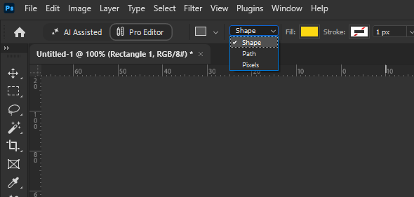
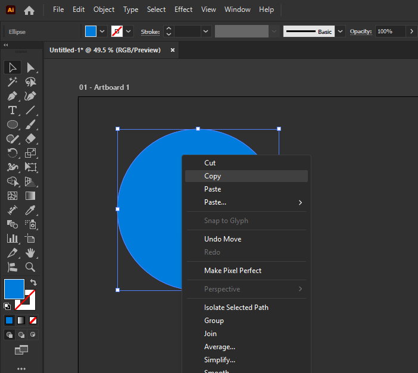
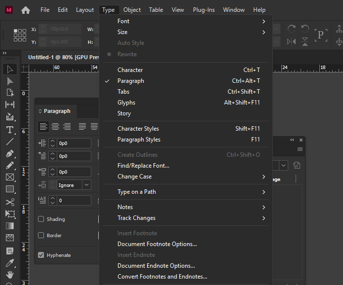
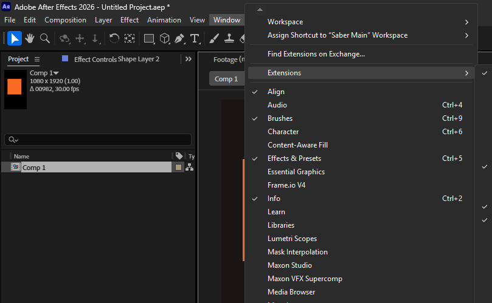
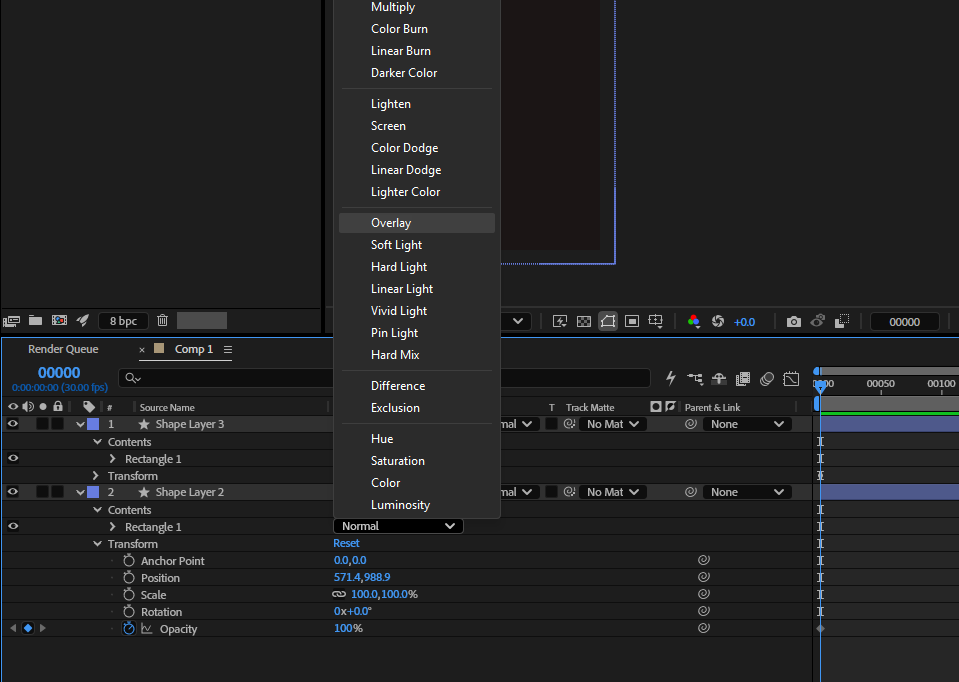
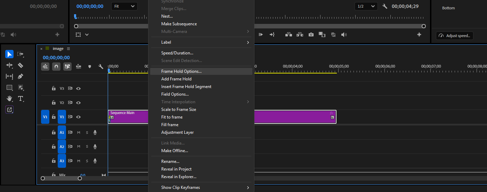
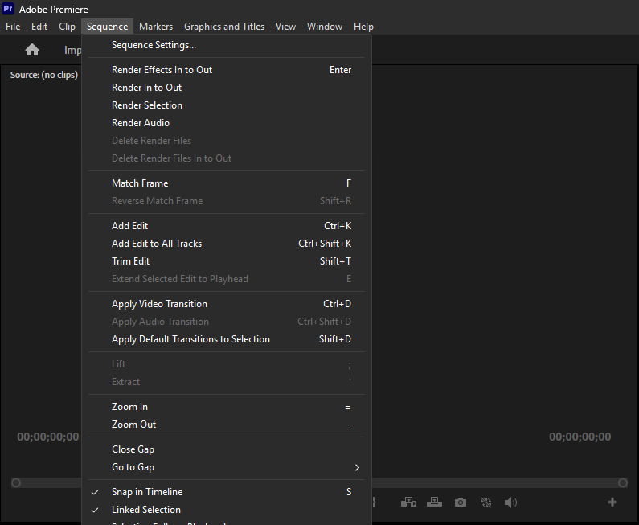

# Adobe Dark Menus

This Windhawk mod gives Adobe apps on Windows dark menus: real menu bars, top-bar dropdowns, context menus and dropdown lists. It also colors their standard title bars to match.

Everything happens inside each app's own process. No system colors are changed and no other application is affected.

## Supported apps

Photoshop, Illustrator, InDesign, Dreamweaver, After Effects, Premiere Pro, Audition, Media Encoder, Bridge and Acrobat.

## Screenshots

**Photoshop:** a dropdown list in the options bar

**Illustrator:** a context menu

**InDesign:** the Type menu

**After Effects:** the Window menu, with the menu bar and title bar

**After Effects:** the blend modes on a timeline layer

**Premiere Pro:** a context menu on a timeline clip

**Premiere Pro:** the Sequence menu, with the menu bar and title bar

## Related mods

These overlap with this mod. Running them together in the same app has not been tested, so use one or the other for the apps above.

- **[Photoshop Dark Menus](https://windhawk.net/mods/photoshop-dark-menus)** covers Photoshop only. This mod does everything it did and reaches the other Adobe apps, so disable it if you use this one.
- **[Dark mode context menus](https://windhawk.net/mods/dark-menus)** darkens the menus Windows draws, in every app and in fixed colors. It does not reach menus an app draws itself, which is why Photoshop stays light with it, or dropdown lists. This mod uses the same technique for the menus Windows draws, so exclude the Adobe apps from it in its Advanced tab.
- **[Windows 11 Custom Title Bar Colours](https://windhawk.net/mods/win11-custom-title-bar-colours)** colors title bars in every app. If you prefer it, turn off **Dark Title Bars** here.

## Requirements

- **[Windhawk](https://windhawk.net) 1.5 or later.** The mod uses the typed `SetFunctionHook` helper, which was added in 1.5.
- **Windows 10 1903 or later** for the menus Windows draws itself. On older builds those menus stay light, and only menus an app draws itself are darkened.
- **Windows 11** for custom title bar colors. Windows 10 2004 or later still gets a dark title bar, in Windows' own color.

There is no toolchain to install. Windhawk compiles the mod itself with its own bundled compiler.

## Installation

1. Download `adobe-dark-menus.wh.cpp` from this repository
2. Open Windhawk
3. Click **Create a new mod**
4. Replace everything in the editor with the contents of the downloaded file
5. Compile it, and Windhawk will build and install it

The apps do not need to be restarted.

## Options

The following settings can be customized in the Windhawk mod panel:

- **Menu Background Color**: Background color (Default: `#2D2D2D`).
- **Menu Text Color**: Text color for active items (Default: `#DCDCDC`).
- **Highlight Background Color**: Color when hovering over an item (Default: `#505050`).
- **Highlight Text Color**: Text color when hovering over an item (Default: `#FFFFFF`).
- **Separator Line Color**: Color for separator lines. Set to match the background color to hide them completely (Default: `#383838`).
- **Disabled Text Color**: Text color for disabled menu items (Default: `#808080`).
- **Border Color**: Color of the frame around menus an app draws itself and around dropdown lists. Leave empty to keep the system frame on those menus and to use the background color on lists (Default: `#2D2D2D`).
- **Theme Dropdown Lists**: Darken the dropdown lists an app draws itself, using the colors above (Default: on).
- **Darken Menus Windows Draws**: Use Windows' dark menu theme, and paint real menu bars dark (Default: on).
- **Dark Title Bars**: Color standard title bars to match the menus (Default: on).
- **Title Bar Color**: Leave empty to match Menu Background Color (Default: empty).
- **Title Bar Text Color**: Leave empty to let Windows choose, which dims the text on a window that is not active (Default: empty).

Colors can be given as `#RRGGBB` or the short `#RGB` form.

The colors apply to real menu bars, to menus an app draws itself (Photoshop's) and to dropdown lists. Menus Windows draws itself keep Windows' own dark colors.

## How it works

Adobe's apps do not all draw their menus the same way, and sharing a library does not settle it: Illustrator and InDesign ship the same `AdobeOwl.dll` as Photoshop, yet Windows draws their menus and Photoshop draws its own. So the mod decides menu by menu, by whether the items are owner-drawn (`MFT_OWNERDRAW`).

| Kind of menu | Who paints it | How the mod darkens it |
| --- | --- | --- |
| Dropdowns and context menus in most apps | Windows, through its theme engine | `SetPreferredAppMode(ForceDark)` and `FlushMenuThemes` |
| Real menu bars, such as After Effects' | Windows, offered to the window first | `WM_UAHDRAWMENU` and `WM_UAHDRAWMENUITEM`, handled in a `DefWindowProc` hook |
| Scroll arrows on long menus | The Windows kernel, directly in light colors | painted over straight afterward, from a subclass on the popup |
| Photoshop's dropdowns and context menus | The app, owner-drawn with plain GDI | hooks on `FillRect`, `PatBlt`, `GetSysColor` and `GetSysColorBrush`, scoped to the item being painted |
| Dropdown lists an app draws itself | The app, into the system's `ComboLBox` | the same hooks, scoped to the list's painting |

The system color overrides apply **only while a menu item or a dropdown list is actually being painted**, rather than for as long as a menu or list happens to be open. `TrackPopupMenu` runs a modal message loop which keeps dispatching to every other window on the thread, so a panel repainting behind an open menu would otherwise come out in menu colors.

A dropdown list whose rows Windows draws is left alone, the same rule as for menus. Windows fills it from a brush no hook can reach, so recoloring the text alone would leave light text on white. So is a list that stays open inside a dialog, such as the ones in the font picker.

Title bars need no drawing at all. The mod sets `DWMWA_USE_IMMERSIVE_DARK_MODE` and `DWMWA_CAPTION_COLOR` on each top-level window with a caption, and puts them back when it is disabled. A window that draws its own title bar, such as the main window of Photoshop, Illustrator or InDesign, is left alone. This is checked per window, so the dialogs in those apps are still colored. A dialog's contents stay whatever color the app or Windows paints them.

## Scope

Anything an app paints from its own palette rather than from a system color or the theme is out of reach, such as Photoshop's font browser and the Glyphs panel's character cells.

A dropdown list Windows draws itself keeps its normal colors.

Long menus scroll rather than splitting into columns, because Windows turns its theme off for any menu that has columns, which leaves them light.

## Credits

- The dark theme technique comes from [Dark mode context menus](https://github.com/MGGSK/DarkMenus) by MGGSK.
- The menu bar messages were worked out in [win32-custom-menubar-aero-theme](https://github.com/adzm/win32-custom-menubar-aero-theme) by adzm.
- The idea of matching the title bars comes from [Windows 11 Custom Title Bar Colours](https://windhawk.net/mods/win11-custom-title-bar-colours) by Th3Fanbus.

## Reporting a bug

Open an [issue](https://github.com/sabergraphics/adobe-dark-menus/issues). Menu drawing depends on more of the environment than most bugs do, so please include:

- The Adobe app and version, and which menu or dropdown list is wrong
- Your Windows version and display scaling, for example 150%
- Your Windhawk version and the mod version
- A screenshot, which is usually worth more than a description here

## License

MIT. See [LICENSE](LICENSE).
